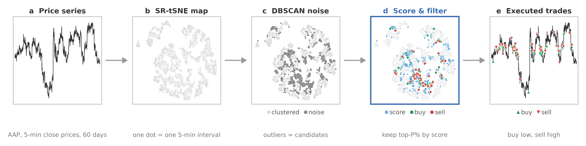

# DBSCAN+K: Cost-Aware Marker Detection for Intraday Trading

Anonymous code and data release for an ICAIF 2026 submission.



DBSCAN+K detects intraday trading markers on a 2-D SR-tSNE embedding of 5-minute
bars: DBSCAN noise points are candidate markers, each candidate is scored by
geometric isolation plus high-/low-dimensional neighbor mismatch (DLP), and only
the top-*P*% per direction is kept, with *P* set by a single global
cost-to-filter rule shared by all stocks.

## Layout

```
data/      35 U.S. equities, 5-min bars, ~60 trading days (2026), one CSV per ticker
cache/     precomputed 2-D embeddings per ticker (SR-tSNE lambda=1.0; legacy file prefix `srtsne`, and t-SNE for the original detector).
           The walk-forward windows are NOT shipped; run src/embed_walkforward.py to build them.
results/   result CSVs shipped for table/figure reproduction; scripts also write here
src/       all code (see below)
```

## Environment

Python 3.10+, see `requirements.txt` (tested versions pinned). PyTorch is only
needed to recompute embeddings; everything downstream of `cache/` is CPU-only.

```
pip install -r requirements.txt
```

## Reproduce the paper

Run everything **from the repository root**.

**Tables** (from the shipped result CSVs, seconds):

```
python src/gen_tables_30.py        # Table 2 (per-stock); also writes a ticker table and a vs-B&H summary (not in the paper)
python src/gen_tab_ablation.py     # Table 5 (DLP-weight ablation)
python src/compute_baselines_bps.py    # Table 3 numbers (printed to stdout)
python src/compute_risk_ablation.py    # Table 4 numbers at 0.5 bp + filter ablation (printed)
python src/select_pstar_pilot.py   # P*(c) schedule selection on the 2019 sixteen-stock pilot (printed win matrix)
python src/execution_nextopen.py   # next-bar-open fill robustness -> results/nextopen_results.csv
```

The cost-to-filter schedule `P*(c) = 80/80/50/40/10` was fixed on a
sixteen-stock pilot (one-minute bars, 2019) that shares no tickers and no
time period with the thirty-five-stock panel. The pilot grid ships as
`results/pilot_grid16.csv`; `src/select_pstar_pilot.py` reproduces the
selection and shows that the paper value attains the maximum win count
against buy-and-hold at every cost level.

**Full recomputation from data + cached embeddings** (CPU, ~10–25 min each):

```
python src/grid_panel.py 0 1    # trading grid over all P and cost levels -> results/grid_part0.csv
python src/ablation_w.py           # DLP-weight ablation grid -> results/grid_ablation_w.csv
python src/compute_baselines_perstock.py   # timing baselines per stock -> results/baselines_perstock35.csv
python src/compute_risk_multi.py   # Table 4 at all three cost levels (0/0.5/2 bp) -> results/risk_multi.csv
```


**Out-of-sample walk-forward** (Sec. 5, two steps; step 1 is the slow one):

```
python src/embed_walkforward.py   # 40/20 day windows embedded independently -> cache/
python src/walkforward_eval.py    # P* chosen on the fitting window, frozen, applied to the test window
```

Step 1 re-embeds every window from scratch because t-SNE is transductive:
slicing a full-window embedding in time would let test-period bars take part in
the embedding. Expect roughly 2-3 minutes per ticker on CPU. Because t-SNE is
platform-dependent (see the note above), the levels this reproduces will differ
from the paper by a few tenths of a percentage point.

**Supporting analyses** (each writes to `results/` or prints to stdout):

```
python src/cluster_ablation.py    # Table 8: HDBSCAN / OPTICS in place of DBSCAN
python src/bootstrap_tests.py     # Table 4: block bootstrap over trading days
python src/dlp_independence.py    # Sec. 3.2.3: rank correlation of the two score components
```

**Figures**:

```
python src/plot_fig_pipeline.py    # Fig 1: pipeline on real data (also this README's banner)
python src/plot_fig_markers_trades.py  # Fig 2: markers on the embedding -> executed trades (AAP, 2bp)
python src/plot_crossover_30.py    # Fig 3: cost crossover
python src/plot_fig_analysis.py    # Fig 4: analysis panels
python src/plot_equity_30.py       # Fig 5: equity curves
python src/plot_fig1_v2.py         # legacy method illustration (not in the paper)
```

**Recompute embeddings from scratch** (optional, GPU, ~45 s per stock):

```
python src/embed_stocks.py     # t-SNE + SR-tSNE for every CSV in data/ -> cache/
```

> **Reproduce from the shipped `cache/`, not by recomputing.** t-SNE is
> platform-dependent, and the pipeline is sensitive to it: re-running the line
> above on another machine moved AAP's original-detector 2 bp net return from
> -1.255% to -2.723%. All paper numbers come from the shipped embeddings.

## Code map

| File | Role |
|---|---|
| `src/sr_tsne.py` | SR-tSNE: t-SNE with a differentiable rank-preservation (DLP) regularizer (legacy module name `sr_tsne`) |
| `src/dbscan_k_v2.py` | DBSCAN+K detector: adaptive eps, noise scoring (isolation + DLP), top-*P*% filter |
| `src/insample_fixP.py` | trading simulator (`run_trading`), original detector, shared helpers |
| `src/compute_baselines*.py` | buy-and-hold and classical timing baselines (MA, RSI, momentum, random) |
| `src/grid_panel.py`, `src/ablation_w.py` | result grids over *P*, cost, and DLP weight |
| `src/select_pstar_pilot.py` | P*(c) schedule selection on the 2019 pilot grid (`results/pilot_grid16.csv`) |
| `src/embed_walkforward.py`, `src/walkforward_eval.py` | out-of-sample 40/20 walk-forward (Sec. 5) |
| `src/cluster_ablation.py` | candidate-generator ablation (Table 8) |
| `src/bootstrap_tests.py` | block bootstrap and multiple-comparison correction (Table 4) |
| `src/dlp_independence.py` | correlation of the geometric and DLP components (Sec. 3.2.3) |
| `src/gen_tab*.py`, `src/plot_*.py` | paper tables and figures |

## Data note

The per-ticker CSVs are normalized 5-minute feature files derived from publicly
available Yahoo Finance data and are provided solely for research
reproducibility. They are not investment advice and must not be redistributed
for commercial use.
